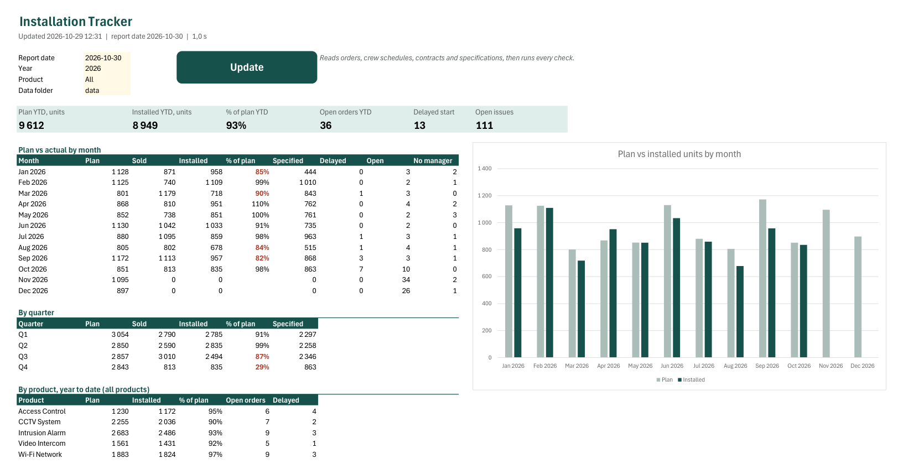
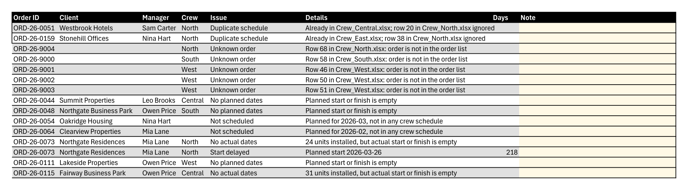
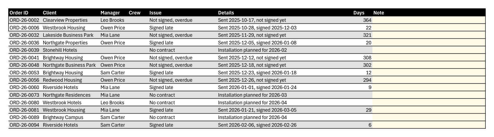
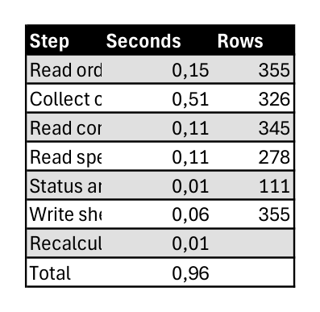
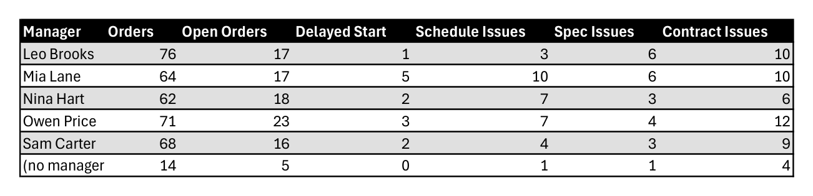

# Installation Tracker

One click collects the schedules of five crews from five differently formatted Excel files, joins them with orders, contracts and specifications, sets a status for every order and lists every problem on three issue sheets. The dashboard (plan vs actual by month, quarter and product) is made of dynamic-array formulas, so it reacts at once to the Year and Product filters. Notes that people type next to an issue stay there across updates.

Excel VBA with Excel 365 formulas (LET, SEQUENCE, SORT, UNIQUE, SUMIFS, COUNTIFS). All data is generated demo data.



## The problem

An installation company plans its jobs by month. Sales keeps the order list, every crew leader keeps a schedule file in their own format, and the office keeps contracts and completed-work specifications. To see where the plan stands, someone copies it all into one report by hand. Problems stay hidden until they are expensive:

- orders that never got into any crew schedule
- starts that slipped, or dates that were never filled in
- installed jobs without a specification, so they cannot be invoiced
- contracts sent weeks ago and still not signed

## What one click does

1. Reads orders, contracts and specifications.
2. Collects the schedules of all crews. It finds the header row, maps differently named columns (`Plan Start`, `Planned From`, `Planned Start`), and reads dates and numbers stored as text. When an order appears in two crew files, the first file wins and the second row is reported.
3. Sets a status for every order on the report date.
4. Runs the checks and fills three issue sheets and a summary per manager.
5. Keeps the notes typed in the Note column. A note follows its issue by key; when the issue is closed, the note moves to Notes Archive instead of disappearing.
6. Recalculates the dashboard and writes the time of every step to the Run Log.



## Metric definitions

R is the report date (Dashboard, cell C4). The report month is the month of R.

**Order status**, the first rule that applies:

| Status | Rule |
|---|---|
| Installed | Actual finish ≤ R and installed units ≥ planned units |
| In progress | Actual start is filled |
| To schedule | No crew schedule, or no planned start |
| Delayed start | Planned start < R |
| Scheduled | All other orders |

**Dashboard figures**

| Figure | Definition |
|---|---|
| Plan | Planned units, by planned month |
| Sold | Planned units, by month of the order date |
| Installed | Installed units, by month of the actual finish |
| % of plan | Installed / Plan; empty for months after the report date |
| Specified | Units on specifications, by specification date |
| Delayed, Open, No manager | Orders of the planned month with status Delayed start, with any status except Installed, without a manager |
| YTD | From 1 January to the end of the report month |

**Checks**

| Sheet | Issue | Rule | Days |
|---|---|---|---|
| Schedule Issues | Not scheduled | No crew schedule, planned month ≤ report month | |
| | No planned dates | Planned start or finish is empty | |
| | No actual dates | Units installed but no actual start, or all units installed but no actual finish | |
| | Finish before start | Actual finish earlier than actual start | |
| | Start delayed | Status Delayed start | R − planned start |
| | Duplicate schedule | The same order in a second crew file | |
| | Unknown order | Schedule row for an order that is not in the order list | |
| Spec Issues | No specification | Installed, no specification 14 days after the finish | R − actual finish |
| | Specification incomplete | Specified units < installed units | |
| Contract Issues | Signed late | Signed more than 14 days after sending | days over 14 |
| | Not signed, overdue | Not signed and sent more than 14 days ago | days over 14 |
| | No contract | No contract, installation planned up to next month | |



## Tested against an independent calculation

`tools/generate_demo_data.py` writes the demo files and, separately from the VBA code, calculates in Python what the workbook must show. `tools/test_tracker.ps1` runs the update and compares:

- the status of all 355 orders
- the count of every issue type (111 issues in total)
- every figure of the monthly table, the product table and the KPI tiles
- that a typed note survives an update and that the note of a closed issue lands in Notes Archive

Result on the demo data: **130 checks passed, 0 failed**. The update takes about 1 second for 355 orders, 333 schedule rows, 345 contracts and 278 specifications.

| Run Log | Managers |
|---|---|
|  |  |

## How to run

### Use the workbook

1. Download or clone the repository. If you download the ZIP, unblock it before you extract it: right-click the ZIP > **Properties** > tick **Unblock** > **OK**. Windows marks downloaded files, and Excel blocks the macros of a marked workbook with no **Enable Content** button. A git clone is not marked.
2. Open `InstallationTracker.xlsm` and click **Enable Content** on the yellow bar. Excel 365 or 2021 is needed for the dynamic-array formulas.
3. Click **Update** on the Dashboard.
4. Change **Year** or **Product** to filter the dashboard; no macro needed.

If Excel shows a red bar *Microsoft has blocked macros from running because the source of this file is untrusted*, the workbook is still marked. Close it, right-click `InstallationTracker.xlsm` > **Properties** > tick **Unblock** > **OK**, and open it again. The data files can stay marked: the macro reads them anyway.

### Build from source and test

```powershell
python -m pip install -r requirements.txt
python tools/generate_demo_data.py
powershell -ExecutionPolicy Bypass -File tools\build_workbook.ps1
powershell -ExecutionPolicy Bypass -File tools\test_tracker.ps1
```

The build needs Excel for Windows with *Trust access to the VBA project object model* switched on. Without it, import the `.bas` files by hand (Alt+F11, File > Import File) into a macro-enabled workbook saved in the project folder, then run `SetupWorkbook` and `UpdateTracker`.

Excel saves the folder of the workbook inside the file. After Excel has closed, the build runs `tools/scrub_workbook.ps1`, which removes that path and stops with an error if a local path, the computer name or the Windows user name is still in the file. Run it yourself after saving the workbook by hand:

```powershell
powershell -ExecutionPolicy Bypass -File tools\scrub_workbook.ps1
```

## Project structure

```
order-installation-tracker/
├── InstallationTracker.xlsm   ready-to-run workbook, built from src/
├── src/
│   ├── modMain.bas            Update button: the whole chain with timing
│   ├── modImport.bas          orders, crew schedules, contracts, specifications
│   ├── modChecks.bas          order status, checks, manager summary
│   ├── modNotes.bas           notes kept by key, archive of closed ones
│   ├── modOutput.bas          tables written in one block, formats
│   ├── modDashboard.bas       dashboard formulas and chart
│   ├── modParse.bas           header detection, date and number parsing
│   ├── modSetup.bas           sheets and tables
│   ├── modConfig.bas          names, rules, record layouts
│   └── modUtils.bas           helpers
├── data/                      generated source files and expected.json
├── docs/                      screenshots
└── tools/
    ├── generate_demo_data.py  demo data and expected figures
    ├── build_workbook.ps1     builds the workbook from src/
    ├── scrub_workbook.ps1     removes the saved folder path from the workbook
    └── test_tracker.ps1       golden-master test
```

## Technical notes

- The dashboard has no VBA logic: formulas are written once with `Formula2` in English, and Excel shows them in its own language.
- Conditional formatting and validation use plain values only (`="Installed"`, `=9/10`). Rules with function names or decimals are read in the language of the Excel interface and break on a Polish or German Excel.
- Dates and numbers stored as text are parsed without `CDate` or `CDbl`, so the result does not depend on Windows regional settings.
- Source files are opened read-only and never changed. Each table is written in one block.
- No library references: Dictionary and FileSystemObject are late bound.
- Built with AI-assisted development (Claude Code). Every figure is checked by the golden-master test above.

## Demo data

All companies, people and numbers are generated by `tools/generate_demo_data.py` with a fixed seed. The files get fixed time stamps, so running it again writes the same bytes and git shows no change.

## License

Portfolio project. You may view the code and run the workbook to evaluate it. Reuse, redistribution or resale is not permitted without written permission. Copyright (c) 2026 Denys Zaitsev. All rights reserved.

For permission or custom work: denys.zaitsev.work@gmail.com
